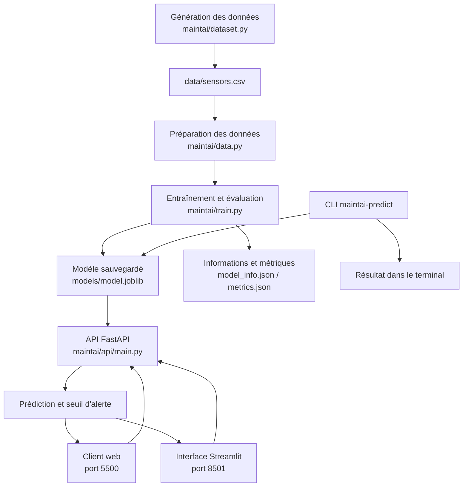

# Étude de conception — MaintAI : prédire les pannes de machines

**Membre :** Rania Bikikre · **Version :** Finale · **Date :** 26/10/2026

## 1. Contexte et utilisateurs

- **Utilisateur principal :** Le responsable de maintenance d'une usine, chargé de planifier les inspections des machines.
- **Contexte :** Chaque matin, l'équipe de maintenance doit identifier les machines à inspecter afin d'anticiper les pannes et de limiter les interruptions de production.
- **Objectif du système :** Prédire les pannes à partir des données des capteurs afin d'aider l'équipe à prioriser les inspections.

## 2. Problème et décision

- **Décision que l'utilisateur prend avec le système :** Choisir les machines à inspecter en priorité en fonction du risque de panne prédit.
- **Fréquence :** Toutes les 5 minutes.
- **Coût d'une erreur, et pour qui :**
  - **Faux négatif :** Une panne réelle n'est pas détectée, ce qui peut entraîner l'arrêt d'une ligne de production pendant une journée.
  - **Faux positif :** Une machine est signalée à tort et nécessite une heure d'inspection inutile.
- **Enjeu principal :** Réduire les pannes manquées tout en limitant les inspections inutiles.

## 3. Approche par sous-problème

| Sous-problème | Approche (règles / ML / DL / LLM / RAG) | Pourquoi pas une approche plus simple |
|---|---|---|
| Prédiction des pannes | Machine Learning supervisé : classification binaire | Des seuils fixes sur chaque capteur ne permettent pas toujours de détecter des combinaisons complexes de valeurs annonçant une panne. |
| Identification des machines à risque | Classification à partir de la température, des vibrations, de la charge et des heures de fonctionnement | Une simple règle fondée sur un seul capteur peut manquer des situations à risque. |
| Comparaison des modèles | Évaluation avec une baseline, une régression logistique, une forêt aléatoire, un Gradient Boosting et les k plus proches voisins | Tester plusieurs modèles permet de vérifier si une méthode plus complexe apporte réellement un gain. |
| Aide à la décision | Règles de priorisation fondées sur les prédictions du modèle | Un LLM ou un système RAG n'est pas nécessaire pour prédire une panne à partir de données numériques structurées. |

## 4. Données

| Jeu de données | Source et licence | Volume | Données personnelles ? |
|---|---|---|---|
| `data/exemple_pannes.csv` | Fichier fourni pour le TP ; licence non précisée | 5 000 relevés de capteurs | Non, selon la description du jeu de données |

**Variables utilisées :**
- Température
- Vibration
- Charge
- Heures de fonctionnement

**Variable cible :** `failure`, indiquant si une panne est survenue.

**Répartition de la cible :** 17,6 % des relevés se terminent par une panne.

## 5. Métriques, baseline et critères d'acceptation

- **Baseline :** `DummyClassifier` avec la stratégie `most_frequent`, qui prédit systématiquement la classe majoritaire.
- **Score de la baseline :** Recall = 0,000 ; accuracy = 0,824.
- **Métrique principale :** Le recall, car une panne manquée peut provoquer l'arrêt d'une ligne de production pendant une journée. Il est donc important de détecter un maximum de pannes réelles.
- **Métriques complémentaires :**
  - Accuracy : proportion totale de prédictions correctes.
  - Precision : proportion des alertes de panne qui correspondent à de vraies pannes.
  - F1-score : moyenne harmonique entre la précision et le recall.

**Critères d'acceptation proposés :**

1. Le modèle doit obtenir un recall supérieur à celui de la baseline.
2. Le recall doit atteindre au moins 0,80 sur le jeu de test.
3. La précision doit être examinée pour évaluer le volume d'inspections inutiles générées par les alertes.
4. Les résultats doivent être évalués sur des données qui n'ont pas servi à entraîner le modèle.

Le seuil de recall de 0,80 est une cible de conception proposée, à confirmer avec le responsable de maintenance.

## 6. Architecture du système

MaintAI est organisé en plusieurs composants qui assurent la génération et la préparation des données, l'entraînement du modèle, la prédiction et l'accès aux résultats.

### 6.1. Architecture générale

Le système suit deux flux complémentaires :

- **Flux d'entraînement :** Les données sont générées ou chargées, préparées et utilisées pour entraîner et évaluer le modèle. Le modèle entraîné est ensuite sauvegardé dans le dossier `models/`, accompagné de ses informations et de ses métriques.
- **Flux de prédiction :** Les interfaces transmettent les relevés de capteurs à l'API, qui utilise le modèle chargé pour calculer la probabilité de panne et retourner une alerte éventuelle. La CLI permet également d'effectuer une prédiction directement à partir du modèle local, sans passer par l'API.

**Schéma général de l'architecture :**

### 6.2. Composants et emplacement

| Composant | Emplacement | Rôle |
|---|---|---|
| Génération des données | `maintai/dataset.py` | Générer les relevés synthétiques dans `data/sensors.csv`. |
| Préparation des données | `maintai/data.py` | Charger les données et préparer les jeux d'entraînement et de test. |
| Entraînement | `maintai/train.py` | Entraîner, évaluer et sauvegarder le modèle. |
| Modèle | `models/model.joblib` | Stocker le modèle entraîné pour les prédictions. |
| API | `maintai/api/main.py` | Exposer les fonctionnalités de prédiction avec FastAPI. |
| Sécurité | `maintai/api/security.py` | Vérifier la clé API transmise dans l'en-tête `X-API-Key`. |
| Client web | `web/index.html` | Permettre de demander une prédiction depuis un navigateur. |
| Interface Streamlit | `ui/app.py` | Explorer les données et demander une prédiction. |
| CLI | `maintai/cli.py` | Effectuer une prédiction directement depuis le terminal. |

### 6.3. Communication et déploiement

Dans la configuration locale utilisée pour le projet :

| Élément | Adresse ou port | Fonction |
|---|---|---|
| API FastAPI | `http://localhost:8000` | Recevoir les demandes de prédiction. |
| Documentation API | `http://localhost:8000/docs` | Consulter et tester les endpoints. |
| Client web | `http://localhost:5500` | Accéder à l'interface HTML/JavaScript. |
| Streamlit | `http://localhost:8501` | Accéder à l'interface d'exploration et de prédiction. |

L'API expose notamment deux endpoints :

- `GET /health` : vérifier l'état de l'API et indiquer si le modèle est chargé.
- `POST /v1/predict` : recevoir un relevé de capteurs et retourner le résultat de la prédiction.

Les routes sous `/v1` sont protégées par une clé API transmise dans l'en-tête `X-API-Key`. Cette clé est configurée avec la variable d'environnement `MAINTAI_API_KEY` et doit être conservée secrète.

Le middleware CORS autorise les origines configurées dans `MAINTAI_CORS_ORIGINS`. Par défaut, les deux origines locales du client web sur le port 5500 sont autorisées. CORS contrôle les origines des requêtes du navigateur, mais ne remplace pas l'authentification par clé API.

L'API et les interfaces sont exécutées séparément, dans des terminaux distincts. Le client web est servi avec le serveur HTTP de Python et Streamlit possède son propre serveur.

La commande `maintai-predict` constitue une autre possibilité : elle charge directement le modèle local et effectue une prédiction sans passer par l'API.

## 7. Choix technologiques

| Technologie | Utilisation et justification | Alternative non retenue |
|---|---|---|
| Python | Langage commun à la préparation des données, à l'entraînement et au développement de l'application. | Utiliser plusieurs langages aurait complexifié l'intégration des composants. |
| Pandas et NumPy | Manipuler les données tabulaires et effectuer les opérations numériques nécessaires à la préparation des relevés. | Un traitement manuel aurait été moins adapté à la manipulation de plusieurs milliers de relevés. |
| Scikit-learn | Entraîner, comparer et évaluer plusieurs modèles de classification supervisée. | Le Deep Learning n'est pas nécessaire pour ce problème tabulaire et ce volume de données. |
| Joblib | Sauvegarder et recharger le modèle entraîné sans devoir le réentraîner à chaque démarrage de l'application. | Réentraîner le modèle à chaque prédiction aurait été inutilement coûteux. |
| FastAPI | Exposer le modèle sous forme d'API REST et valider les données reçues. Sa documentation interactive facilite les tests. | Une application sans API aurait rendu plus difficile la réutilisation du modèle par plusieurs interfaces. |
| Uvicorn | Exécuter le serveur ASGI nécessaire au fonctionnement de FastAPI. | Un serveur de développement intégré ne constitue pas le mode d'exécution retenu pour cette API. |
| Streamlit | Créer rapidement une interface Python pour explorer les données et tester les prédictions sans développer une interface complète. | Une interface entièrement développée avec un framework JavaScript aurait demandé davantage de développement côté frontend. |
| HTML et JavaScript | Fournir un client web léger permettant de communiquer avec l'API depuis un navigateur. | Une interface plus complexe n'était pas nécessaire pour la démonstration. |
| Pytest | Vérifier automatiquement le fonctionnement des composants et limiter les régressions. | Des tests uniquement manuels seraient moins reproductibles. |
| Setuptools et pyproject.toml | Structurer MaintAI comme un package Python installable et déclarer la commande `maintai-predict`. | Exécuter uniquement les scripts depuis leur dossier aurait limité la réutilisation et la distribution du projet. |

Le choix d'une classification supervisée est adapté à la nature des données : les entrées sont des mesures numériques et la cible indique la présence ou l'absence d'une panne. Un LLM ou un système RAG n'apporterait pas de valeur nécessaire à cette prédiction.

## 8. Risques, éthique et confidentialité

- **Pannes manquées (faux négatifs) :** Une panne réelle peut ne pas être détectée par le modèle. Cela peut provoquer un arrêt de production et entraîner des pertes pour l'entreprise. L'équipe de maintenance et la production sont les premières concernées.
- **Fausses alertes (faux positifs) :** Une machine peut être signalée à tort, ce qui entraîne une inspection inutile et mobilise du temps et des ressources de l'équipe de maintenance.
- **Qualité des données :** Des capteurs défectueux, des valeurs manquantes ou des relevés incorrects peuvent fausser les prédictions et réduire la fiabilité du système.
- **Biais et représentativité :** Les données synthétiques utilisées pour l'entraînement ne représentent pas nécessairement toutes les conditions de fonctionnement d'une véritable usine. Le modèle peut donc être moins performant sur des équipements ou des situations différents.
- **Confidentialité :** Le jeu de données utilisé contient des mesures techniques de machines et ne comporte pas de données personnelles identifiées, selon sa description. Toutefois, les données industrielles réelles peuvent être confidentielles et doivent être protégées contre les accès non autorisés.
- **Sécurité de l'application :** L'API utilise une clé d'authentification transmise dans l'en-tête `X-API-Key`. Cette clé doit rester secrète, être stockée dans une variable d'environnement et ne pas être publiée dans le code source ou sur GitHub.
- **Responsabilité humaine :** MaintAI est un outil d'aide à la décision et non un système de décision autonome. Le responsable de maintenance doit examiner les alertes et tenir compte des procédures de sécurité et de son expertise avant toute intervention.
- **Limites éthiques :** Les prédictions ne doivent pas être considérées comme des certitudes. Les performances du modèle doivent être évaluées régulièrement, notamment sur des données réelles, avant toute utilisation industrielle.

## 9. Limites et éléments hors périmètre

La version actuelle de MaintAI constitue un prototype pédagogique. Plusieurs limites doivent être prises en compte avant d'envisager une utilisation industrielle.

- **Données synthétiques :** Le modèle est entraîné sur des données générées pour le projet. Ses performances ne garantissent pas les mêmes résultats sur les machines d'une véritable usine.
- **Absence de connexion directe aux capteurs :** L'application ne récupère pas automatiquement les mesures depuis des machines, des automates industriels ou un système de supervision. Les relevés sont fournis aux interfaces pour effectuer les prédictions.
- **Absence de surveillance automatique :** Le système ne lance pas de prédictions toutes les cinq minutes de manière autonome et ne dispose pas d'un mécanisme de surveillance continue.
- **Périmètre de prédiction limité :** MaintAI prédit une probabilité de panne à partir de quatre variables. Il ne détermine pas la cause exacte d'une panne, sa durée de vie restante ou les réparations à effectuer.
- **Absence d'intervention automatique :** Le système ne commande pas les machines, ne déclenche pas directement les opérations de maintenance et ne remplace pas le responsable de maintenance.
- **Absence de réentraînement automatique :** La mise à jour du modèle nécessite une nouvelle préparation des données et une nouvelle exécution de l'entraînement.
- **Déploiement limité :** La configuration actuelle est destinée à une démonstration locale. La disponibilité, la supervision, la montée en charge et la sécurisation d'un déploiement industriel restent à mettre en place.

Toute utilisation dans un environnement industriel nécessiterait donc une validation sur des données réelles, une évaluation des risques et une supervision humaine des décisions.