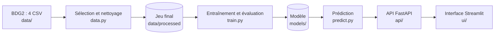

# Étude de conception — Prévision de la consommation électrique de bâtiments tertiaires
 
Groupe : 
Version : brouillon · Date : [11/10/2026]
 
> Brouillon des sections 1 à 5 (les sections 6 à 9 sont des pré-brouillons, à finaliser à la séance 6). Les choix marqués « hypothèse » sont à confirmer par le groupe. Les valeurs entre crochets seront **calculées sur les données** (jamais inventées).
 
## 1. Contexte et utilisateurs
 
- Organisation ou situation : un **parc de bâtiments tertiaires** dont la consommation électrique est mesurée heure par heure, bâtiment par bâtiment, et gérée par un service énergie. [Contexte précisé après le choix des bâtiments : campus universitaire, parc de bureaux ou collectivité, selon la composition du site retenu et son profil de consommation.]
- Utilisateur principal (un rôle précis) : le **responsable énergie du parc**. Perspective hors périmètre : exploitants techniques, direction du patrimoine.
 
## 2. Problème et décision
 
- Décision que l'utilisateur prend avec le système : chaque jour, à une heure fixée T, le responsable énergie arrête le plan d'exploitation du lendemain (programmation du chauffage et de la climatisation, bâtiments à préchauffer ou prérefroidir, mesures pour limiter un pic de consommation), à partir de la consommation électrique prévue heure par heure pour chaque bâtiment.
  - **Hypothèse sur T** : fin de matinée (par exemple 11 h), car la programmation du lendemain doit être arrêtée avant la fin de la journée de travail du service énergie. À confirmer avec un utilisateur réel. T fixe ce qu'on a le droit d'utiliser : seules les mesures **connues à T** entrent dans le modèle.
  - *Phrase « utilisateur + décision »* : le responsable énergie du parc arrête chaque jour, à 11 h, le plan d'exploitation du lendemain à partir de la consommation prévue heure par heure pour chaque bâtiment.
- Fréquence : quotidienne (une prévision par bâtiment et par jour, 24 valeurs horaires pour le lendemain).
- Conséquence d'une erreur, et pour qui :
  - **sous-estimation** : pic non anticipé, surcoût (selon le contrat d'énergie, **hypothèse**), inconfort si le chauffage est insuffisant : le service énergie et les occupants sont touchés ;
  - **surestimation** : préchauffage inutile, énergie gaspillée : le budget du parc est touché.
  - L'erreur la plus coûteuse est probablement la sous-estimation aux heures de pointe : [à confirmer avec les données].
 
## 3. Approche par sous-problème
 
| Sous-problème | Approche (règles / ML / DL / LLM / RAG) | Pourquoi pas une approche plus simple |
|---|---|---|
| Préparer des données fiables (valeurs négatives, zéros longs, pics, trous) | **Règles** chiffrées, validées contre le jeu nettoyé fourni par les auteurs du jeu de données | Ces défauts se détectent par des seuils ; un modèle de détection d'anomalies serait plus complexe à justifier |
| Prévoir la consommation horaire du lendemain | **ML** : baselines (même heure 7 jours avant, moyenne des 4 dernières semaines) → régression linéaire (Ridge) → gradient boosting ; options : réseau récurrent, prévision par intervalle | Les baselines **sont** l'approche simple : le ML n'est retenu que s'il les bat d'un seuil chiffré (section 5). Une baseline qui reste compétitive est un résultat défendable |
| Exposer la prévision (API et interface) | **Code applicatif** (FastAPI, Streamlit), sans IA | Exposer un modèle ne demande ni LLM ni modèle supplémentaire |
| Conseiller sur l'efficacité énergétique (après le module ML) | **RAG** sur des guides publics, avec sources citées | Une page statique ou une recherche par mots-clés serait plus simple : le RAG n'est justifié que si le corpus et les questions le demandent [à confirmer avec l'enseignant] |
 
## 4. Données
 
| Jeu de données | Source et licence | Volume | Données personnelles ? |
|---|---|---|---|
| Building Data Genome Project 2 (BDG2) : électricité horaire et météo du site | https://github.com/buds-lab/building-data-genome-project-2 · Miller et al., *Scientific Data* 7, 368 (2020), https://doi.org/10.1038/s41597-020-00712-x · licence **CC BY-SA 4.0** d'après le fichier LICENSE du dépôt [à confirmer dans l'article] | Jeu complet : 1 636 bâtiments, 3 053 compteurs, 2016-2017, ≈ 53,6 M de mesures. **Utilisé** : 1 site [nom], 20 bâtiments × 17 544 heures = 350 880 lignes, plus la météo du site | Pas d'individus : ce sont des mesures par bâtiment. Les identifiants de bâtiments contiennent des prénoms : pseudonymes probables, [à vérifier] |
 
- **Obtention** : fichiers CSV téléchargés depuis le dépôt (stockés avec Git LFS), placés dans `data/` (jamais dans Git ; DVC à la séance 7).
- **Sélection** : électricité seulement, un site, 20 bâtiments tirés au hasard par usage avec graine fixe ; critères et entonnoir dans l'ADR « choix du jeu de données ». Le contexte (campus, bureaux, collectivité) est déduit de ces bâtiments.
- **Nettoyage** : sur les données brutes, règles dans l'ADR « nettoyage des données » ; le jeu nettoyé des auteurs ne sert que de référence de comparaison.
 
## 5. Métriques, baseline et critères d'acceptation
 
- **Baseline et son résultat** : B1 = même heure, 7 jours avant ; B2 = moyenne du même jour de semaine et de la même heure sur les 4 dernières semaines. Toutes deux n'utilisent que des mesures connues à l'heure de production T, quelle que soit T. Évaluées sur les **mêmes lignes** que les modèles : test = année 2017, lignes sans valeur manquante ni valeur interpolée. Résultat : MAE de B1 = [à calculer] kWh, MAE de B2 = [à calculer] kWh (médiane sur les 20 bâtiments).
- **Métrique principale et pourquoi** : MAE (kWh) par bâtiment, et MAE en % de la consommation moyenne du bâtiment pour comparer des bâtiments de tailles différentes. Le coût d'une erreur est proportionnel à l'énergie mal prévue, ce que mesure la MAE. Métrique secondaire : RMSE, qui pénalise les grosses erreurs donc les pics. MAPE écartée : instable quand la consommation est proche de zéro.
- **Critères d'acceptation** (un nombre, un jeu de données, une condition) :
  1. **Performance** : sur le jeu de test 2017 (20 bâtiments, lignes évaluables), la MAE en % du modèle retenu est inférieure d'au moins [X] % à celle de la meilleure baseline, pour la médiane des bâtiments. [X fixé après calcul des baselines.]
  2. **Robustesse** : sur le même jeu de test, le modèle bat la meilleure baseline sur au moins [Y] des 20 bâtiments.
- **Découpage** (proposition) : entraînement sur 2016, test sur 2017 (chronologique) ; réglage des hyperparamètres par validation chronologique **à l'intérieur de 2016**, jamais sur le test.
 
## 6. Architecture prévue (pré-brouillon, à finaliser après la séance 5)
 

 
## 7. Choix technologiques (pré-brouillon, après la séance 5)
 
| Besoin | Outil | Justification |
|---|---|---|
| Manipuler des séries temporelles | pandas, numpy | standard, adapté aux données horaires |
| Modèles | scikit-learn (Ridge), LightGBM [à confirmer] | le gradient boosting domine la compétition qui a utilisé ces données |
| Stocker le jeu final | Parquet (pyarrow) | lecture rapide, types conservés |
| Exposer le modèle | FastAPI | API typée, validation des entrées |
| Interface | Streamlit | démonstration rapide pour l'utilisateur |
| Qualité | pytest | tests sur les données et le code |
| Reproductibilité | Python 3.11, `requirements.txt` épinglé, DVC (S7) | mêmes versions chez tous, données versionnées hors Git |
| Livraison | Docker, docker-compose, GitHub Actions (S8) | exécution identique partout, contrôle automatique |
 
## 8. Risques, éthique, confidentialité (pré-brouillon)
 
| # | Question | Réponse provisoire | Mesure |
|---|---|---|---|
| 1 | Données personnelles ? Lesquelles ? | Non : mesures par bâtiment. Identifiants avec prénoms (pseudonymes probables) [à vérifier] | vérifier `metadata`, ne pas utiliser les colonnes `occupants` et de localisation |
| 2 | S'en passer ou anonymiser ? | Aucune donnée personnelle nécessaire | liste des colonnes utilisées dans l'ADR |
| 3 | Qui peut être lésé par une erreur ? | Occupants (inconfort), service énergie (surcoût) | critères d'acceptation 1 et 2, marge de sécurité [à définir] |
| 4 | Les données couvrent-elles tous les cas d'usage ? | Non : un site, un climat, deux années | test sur 2017 séparé ; limite affichée dans l'interface ; second site en option |
| 5 | Quelle erreur coûte le plus, et à qui ? | Sous-estimation aux heures de pointe, pour le parc [à confirmer] | RMSE et erreur sur les 10 % d'heures les plus chargées, rapportées avec la MAE |
| 6 | Qui valide et peut corriger ? | Le responsable énergie reste décisionnaire ; la prévision est une aide | l'interface affiche prévu et réel pour contrôler l'écart |
| 7 | Des données sortent-elles de l'organisation ? | Non pour la prévision (exécution locale ou Docker) ; le RAG pourrait appeler un LLM externe [à décider] | aucune donnée de consommation envoyée à une API externe ; documents publics seulement |
| 8 | Détournement ? | Entrées absurdes envoyées à l'API ; usage hors périmètre | validation des entrées (bornes plausibles), refus des bâtiments inconnus |
 
## 9. Limites et hors périmètre (pré-brouillon)
 
- Météo **mesurée** utilisée à l'entraînement ; en production on aurait des prévisions (erreur de prévision météo non simulée).
- Un site, 20 bâtiments, deux années : généralisation non démontrée.
- Horizon J+1 uniquement : ni temps réel, ni semaine à venir.
- Prévision seulement : aucun pilotage automatique des bâtiments.
- L'assistant RAG vient après le module de machine learning.
